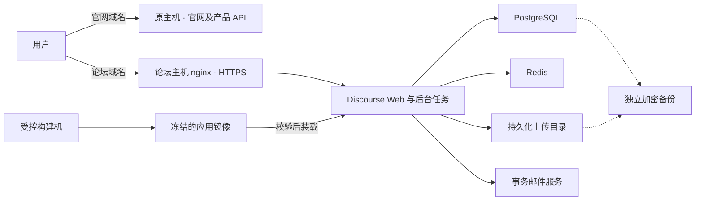

# StormForge 论坛结构与上海部署方案

**规划稿 · 2026-11-18。** 建议以「开物有方 · StormForge 社区」为站名，使用 Discourse 自建。论坛负责答疑、经验交流和问题归集，官网继续提供产品介绍、文档和经核验的发行信息。开发版使用上海二区独立试用机，先限团队使用，到期前迁移到正式论坛机。拟用域名为 `forum.vollagames.com`。普通成员统一使用 StormForge 账户，通过 DiscourseConnect 登录；论坛维护社区资料与角色。执行顺序、验收条件和用户准备清单见[试用开发与正式机迁移路线](discourse-dev-roadmap.md)。

## 1. 首页和版块

首页优先展示分类与最近讨论，顶部置顶「第一次来，从这里开始」，提供查支持范围、提问题、找教程三个入口。采用讨论稿的七个一级分类。分类主名用英文，简介第一句用中文说明发帖范围，置顶导航提供中英文对照。中英文帖子共用同一分类，方便维护者集中回答。

| 一级分类 | 二级分类规划 | 最适合发在这里的内容 |
| --- | --- | --- |
| Announcements & Support · 公告与支持 | 公告与发行、安装与授权、缺陷反馈、功能建议 | 官方消息与需要产品团队跟进的问题。公告区由维护者发布 |
| Blizzard Games · 暴雪游戏 | 魔兽、星际争霸、暗黑破坏神、风暴英雄、守望先锋 | 围绕具体作品的问题。如魔兽系列下用 `wow`、`wc3`、`wc3r` 区分作品 |
| FromSoftware Games · FromSoftware 游戏 | 黑暗之魂、只狼 | 黑暗之魂系列用 `ds1`、`ds1r`、`ds2`、`ds3` 区分。其他作品先在一级分类讨论 |
| Capcom Games · 卡普空游戏 | 生化危机 | 用 `re4r`、`re9` 等作品标签汇集问题，具体游戏构建号填在正文 |
| General Game Engines · 通用引擎 | Unity、Unreal Engine | 通用引擎问题与 StormForge 集成。帖中写明引擎、渲染管线及插件版本，按需加 `il2cpp`、`ue5` 等标签 |
| Modding & Development · 跨游戏技术 | 起步时直接发在一级分类 | 模型与材质、动画、场景、脚本、工具与插件等可跨作品复用的方法。用技术标签检索 |
| Community · 社区交流 | 起步时直接发在一级分类 | 原创作品展示、经验与综合讨论。专属某款游戏的教程归游戏区，再加 `guide` |

**建版节奏。** 邀请试用时建好七个入口，配置公告权限与反馈模板。有负责人和首篇真实内容的系列再开二级分类，其余话题直接发在对应生态下。版主定期查看游戏标签下的主题；当同一系列已形成持续讨论、需要独立置顶索引时，开子版并迁移原帖。游戏补丁和 StormForge 版本保留为正文中的可搜索字段。

**发帖分流示例。** “如何预览 Warcraft III 模型”放在暴雪游戏区，加游戏和 `model` 标签。若同一问题已定位为某个 StormForge 版本的回归，版主将原帖移至缺陷反馈，保留游戏标签、回复与排查过程。维护者需要代码跟踪时，关联公开 GitHub Issue，并把处理结果回填原帖。安全漏洞走项目的私密报告渠道。[项目安全报告说明](../SECURITY.md)

## 2. 标签、支持范围与权限

| Discourse 配置 | 建议设置 |
| --- | --- |
| 游戏与引擎标签 | 游戏标签使用稳定的 Game ID，引擎及运行时标签单独成组。限制系列版块可用的游戏标签；缺陷反馈区允许跨游戏选标签。通用安装问题可留空 |
| 技术与内容标签 | 预建 `model`、`material`、`animation`、`scene`、`script`、`guide`、`showcase`。成员可选用，版主维护词表和同义词 |
| 问题处理状态 | 在反馈区用 `investigating`、`confirmed`、`fixed` 记录进度，由维护者设置；修复后在原帖注明对应产品版本 |
| 官方兼容结论 | 集中在维护者可编辑的置顶「支持范围」主题。每条记录写明 Game ID、游戏构建、StormForge 版本、具体操作、验证结果和公开依据。普通帖子中的游戏标签只用于检索 |

在管理后台启用标签，创建标签组并设置使用权限，再到各分类配置可用或必选的标签组。用普通成员账号核对发帖选择器，用维护者账号核对可修改的状态。Discourse 提供这些配置，无需修改论坛核心。[官方标签管理指南](https://meta.discourse.org/t/admin-guide-to-tags-in-discourse/121041)

**支持信息的维护。** 初期由维护者依据已审核的公开文档或发行记录更新置顶索引，并注明来源版本和日期。后续若上游提供可公开的 Game Registry 快照，可按 Game ID 更新同一主题。仅同步可公开字段。引擎插件能导入某格式、某款游戏能读取某构建的模型、该模型能导出，是三条不同的验证结论。讨论稿中的 RE9、DS3 等是分类示例；缺少公开验证记录时，索引标「暂无公开验证记录」。[项目内容来源](content-sources.md) · [发行规范](../release/README.md)

**发帖权限与模板。** 公开后访客可读公开分类；完成所需核验的成员可在讨论区发帖和回复；发行维护者可发布公告；版主处理举报、移动及合并重复主题；管理员负责站点设置和恢复。许可、订单和账户个案转私密联系。缺陷模板依次收集「StormForge 版本 / 游戏与构建号或引擎版本 / 操作系统 / 重现步骤 / 预期与实际结果 / 脱敏日志」。优先用自制最小样例复现，附件限有权公开的截图等材料。正式下载统一指向官网已核验的发行入口。

## 3. 试用与正式运行架构

1. **试用与选型。** 已开通的上海二区试用机为 S5.MEDIUM4、2 核 4 GB、3 Mbps，系统盘为 50 GB 通用型 SSD。首次登录时核对可用空间。团队使用一套论坛，记录发帖、图片浏览、后台任务和备份时的资源峰值，据此确定正式机规格。[Discourse 官方资源要求](https://github.com/discourse/discourse/blob/main/docs/INSTALL-cloud.md)
2. **构建和升级均在云外完成。** 在同架构 Linux 构建机固定 Discourse 与 `discourse_docker` 提交及插件版本，按官方 Docker 模板制作含已编译静态资源的应用镜像。以测试配置在干净运行环境演练首次建库、迁移、重启及升级，确认启动没有拉源码、安装依赖或编译资源。开发版记录镜像 ID、镜像归档的字节数、小写 SHA-256 及运行配置版本，通过目标论坛机的 SSH 通道交付，运行机校验归档后装载并核对镜像 ID。生产密钥在运行时注入。官方一键安装和 `launcher rebuild` 含引导构建步骤，执行位置应是构建环境。镜像交付是本项目对官方流程的适配，须经演练。[官方 Docker 模板与 launcher 命令](https://github.com/discourse/discourse_docker)
3. **接入独立域名。** 核实 DNS 归属并为论坛域名签发匹配证书。在论坛主机的 nginx 配置独立虚拟主机，论坛 HTTP 仅绑定已确认空闲的回环端口；设置正确的 Host、外部 HTTPS 协议和可信代理范围。配置生效前执行 `nginx -t`。从大陆移动端测试首屏、登录、图片上传及实时通知。迁移时沿用论坛域名并单独切换其解析。[切换与回退步骤](discourse-dev-roadmap.md)
4. **配置数据和邮件。** PostgreSQL、Redis 使用私有连接，数据库与上传目录使用独立持久卷。选择试用机和正式机均可稳定连接的事务邮件服务，验证发件域名及 SPF、DKIM，实际测试邀请、重置密码和通知投递。分别监控论坛可用性、后台任务积压、发信失败、磁盘余量和备份时效。
5. **备份与回退一起验收。** 每日备份数据库和上传文件，加密保存到独立存储；单独保管恢复所需的运行配置、密钥和镜像摘要。在隔离环境用匹配版本恢复，抽查账号、权限、帖子及附件，并关闭演练环境对外发信。升级前暂停写入并留存一致备份；若迁移后的数据库与旧版本不兼容，用升级前的镜像、数据库及附件配套恢复。验收后再开放写入。[官方备份恢复指南](https://meta.discourse.org/t/create-download-and-restore-a-backup-of-your-discourse-database/122710)

## 4. 从内部验收到公众开放

| 阶段 | 完成条件 |
| --- | --- |
| 内容准备 | 确定维护者、版主、发帖规则与举报入口。备齐欢迎导航、支持范围索引、缺陷模板和至少一篇有公开依据的教程。公告只链接已有的真实发行记录 |
| 隔离试运行 | 限定团队访问，用测试身份演练游客、成员、版主、管理员的权限；走通反馈、举报、邮件和恢复。核实试用机和正式机各自的域名接入、证书、容量与恢复结果 |
| 公众注册前 | 运营主体与接入商核实新增论坛服务和域名涉及的备案或变更事项，确认后台真实身份认证流程、版主身份核验、内容巡查、举报处置与负责人。编写覆盖论坛账号、Cookie、帖子、附件、邮件、保存期限和注销申请的协议与隐私说明。用未核验账号验证注册和发言限制 |
| 正式开放 | 完成桌面和手机视觉验收，取得针对论坛的生产部署授权。StormForge 统一登录通过验收后在官网增加「社区」入口，值班人员接手审核、告警和备份检查 |

现有官网备案记录为「浙ICP备2023045009号-2」，现行隐私说明适用于静态网页。论坛引入账号与用户发帖，须按实际服务落实身份认证、版块管理、信息保护及投诉举报机制；邮箱激活只验证邮箱可达性。[项目上线记录](launch-blockers.md) · [现行网站隐私说明](../src/pages/privacy.astro) · [国家网信办《互联网论坛社区服务管理规定》](https://www.cac.gov.cn/2017-08/25/c_1121541921.htm)
